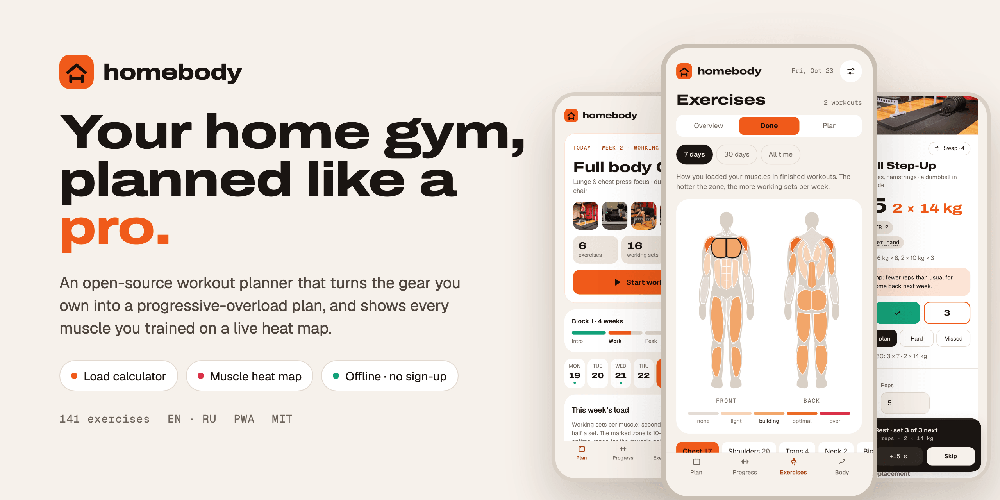
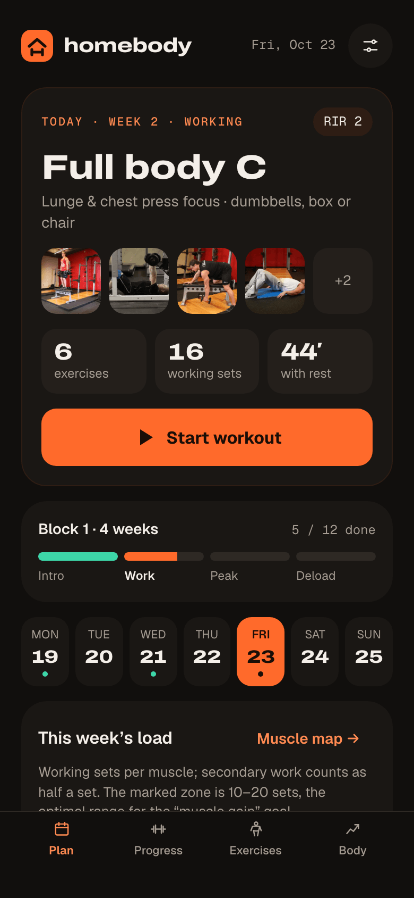
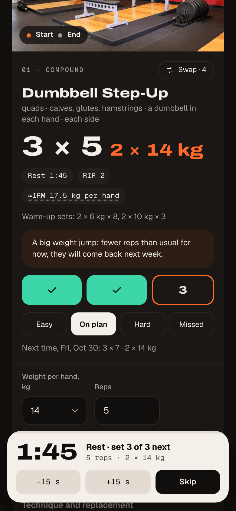
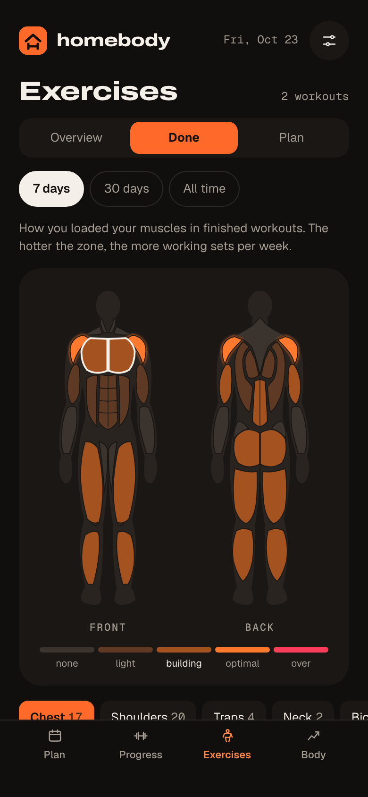
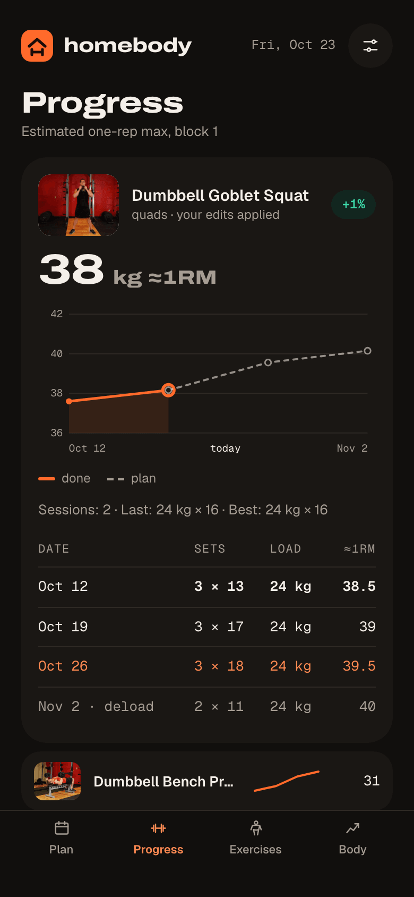
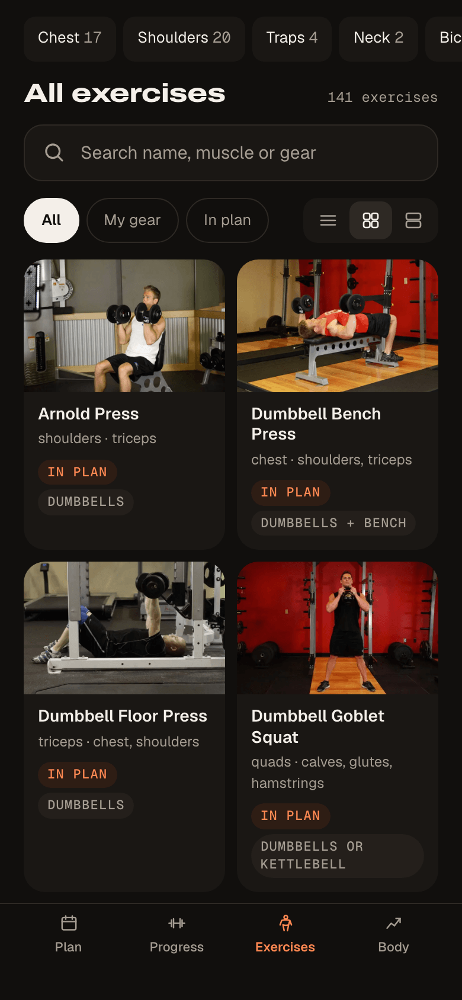
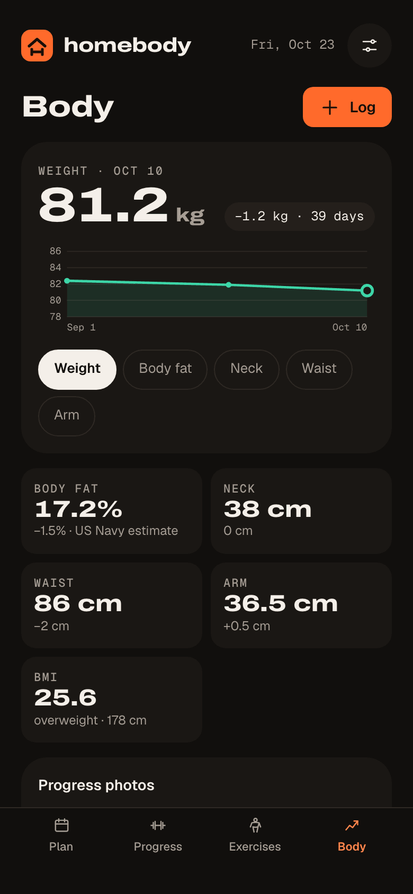
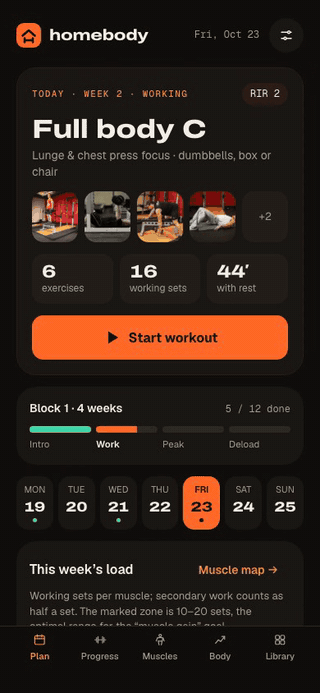

<div align="center">
  
  <h1>Homebody</h1>
  <p><strong>Your home gym, planned like a pro.</strong></p>
  <p>
    A workout planner and load calculator for the equipment you actually own.<br>
    No account, no backend, no tracking. It works offline and your data stays on your device.
  </p>
  <p>
    <a href="https://github.com/khoren93/homebody/actions/workflows/ci.yml"></a>
    <a href="LICENSE"></a>
    <a href="https://khoren93.github.io/homebody/"></a>
    <a href="CONTRIBUTING.md"></a>
    
  </p>
</div>

<picture>
  <source media="(prefers-color-scheme: dark)" srcset="docs/assets/hero-dark.png">
  
</picture>

**[Open the live demo](https://khoren93.github.io/homebody/)** · it starts with a sample plan, so you
can look around before entering anything.

Homebody builds a training plan from your schedule and equipment, tells you how much to lift in
every set, and adjusts the numbers as you log your sessions. It is science-based, runs entirely in
the browser, and can be installed as an app.

## Features

<table>
  <tr>
    <td width="33%"></td>
    <td width="33%"></td>
    <td width="33%"></td>
  </tr>
  <tr>
    <td width="33%"></td>
    <td width="33%"></td>
    <td width="33%"></td>
  </tr>
</table>

**Planning**

- Full body, upper/lower or push/pull/legs, chosen from the days you train.
- Sessions fitted to your time budget, from 20 to 120 minutes.
- Only exercises you can do with your equipment: 12 kinds, from nothing at all to a barbell rack.
- Four-week blocks with a deload week; the next block continues from the level you reached.
- Missed a session? Do it today and the rest of the plan shifts with it, or skip it.

**Load calculator**

- Starting weights from body weight, experience, sex and age, picked from the weights you own.
- Progression driven by estimated one-rep max and reps in reserve.
- Edit any set or rate how it felt, and every later session is recalculated.
- Warm-up sets and a plate breakdown for barbells.

**Workout**

- One card per exercise with start and end photos, technique, sets, reps and load.
- Set tracker with a rest timer that names what comes next, beeps and vibrates.
- Swap an exercise for an alternative that trains the same muscles, by hand or at random.
- The screen stays awake while you train.

**Exercises**

- A front and back body map with 17 muscle groups: tap a muscle to see what trains it.
- Weekly volume as a heat map, planned or actually performed, rated against your goal.
- A catalog of 141 exercises under the map, with search, filters and three levels of detail.

**Body**

- Weight, six girths, BMI and body fat estimated with the US Navy method.
- Charts for every metric and a journal.
- Progress photos by pose with a side-by-side comparison.

**Privacy**

- No analytics, no trackers, no third-party requests: even the fonts are bundled.
- Everything is stored in your browser. Export and import a single backup file whenever you like.
- Installable, and fully usable offline after the first visit.
- English and Russian, light and dark theme.

<p align="center"></p>

## Quick start

You need [Node.js](https://nodejs.org) 24, [pnpm](https://pnpm.io) 10 and `make`.

```sh
git clone https://github.com/khoren93/homebody.git
cd homebody
make install
make dev          # http://localhost:5173
```

Or with Docker, without Node on the host:

```sh
make docker-run   # production image on http://localhost:8080
make docker-dev   # dev server with hot reload on http://localhost:5173
make docker-stop
```

Run `make` to list every target. `make check` runs what CI runs: lint, typecheck, dataset
validation, unit tests and the production build. `make e2e` runs the Playwright tests.

## How it works

The short version; [docs/TRAINING_SCIENCE.md](docs/TRAINING_SCIENCE.md) has every rule and number.

**Effort is prescribed as reps in reserve (RIR)**: how many more reps you could have done at the
end of a set. A four-week block goes 3 → 2 → 1 RIR and then deloads.

**Strength is tracked as an estimated one-rep max**, using the Epley formula extended with RIR:

```
e1RM = weight × (1 + (reps + RIR) / 30)
```

Before you have logged anything, the e1RM is estimated from your profile:

```
e1RM = exercise ratio × body weight × level × sex × age
```

**The weight is chosen from what you own.** For every available weight the calculator works out
the reps it allows at the prescribed RIR and picks the one closest to the target of your goal's rep
range. The estimate grows each week by 0.75–3 % depending on your level, and is re-anchored to
whatever you actually do.

**Volume is counted in hard sets per muscle per week**, with secondary muscles counting as half.
The muscle map compares it with the optimal range of your goal: 10–20 sets for hypertrophy, less
for small muscles.

**Body fat** uses the US Navy circumference method from height, neck and waist (and hips for
women).

> [!NOTE]
> These are simple, transparent population models that give a sensible starting point. Homebody is
> not a coach.

## Tech stack

| Concern  | Choice                                                                      |
| -------- | --------------------------------------------------------------------------- |
| Build    | Vite, TypeScript (strict), pnpm                                             |
| UI       | React, CSS Modules on design tokens, hand-written SVG charts and body map   |
| State    | Zustand; the plan is derived from the state, never stored                   |
| Storage  | IndexedDB through Dexie; Zod validates stored data, backups and the dataset |
| i18n     | i18next, with type-checked keys                                             |
| Offline  | vite-plugin-pwa (Workbox)                                                   |
| Tests    | Vitest and Testing Library; Playwright for end-to-end                       |
| Tooling  | ESLint, Prettier, lefthook, commitlint                                      |
| Delivery | Docker (nginx, unprivileged), GitHub Actions, GitHub Pages                  |

The reasoning behind these choices is in [docs/adr/](docs/adr/), and
[docs/ARCHITECTURE.md](docs/ARCHITECTURE.md) explains how the pieces fit.

## Project structure

```
src/
  engine/        pure TypeScript: plan builder, loads, analytics (no React, no browser)
  data/          schema and loader of the exercise dataset
  store/         state, transforms, derived plan, persistence, backup
  i18n/          setup, locales/en.json, locales/ru.json, formatting
  components/    shared UI building blocks
  features/      plan, session, progress, exercises, body, settings
  app/           shell, tab bar, service worker registration
  styles/        design tokens, fonts, base styles
data/            exercises.json, the dataset
public/          icons and exercise photos
scripts/         dataset validation and sync, icons, screenshots
e2e/             Playwright specs
docs/            architecture, training science, decision records, progress log
```

The engine is the heart of the project. It is deterministic and side-effect free, has over 90 %
test coverage, and is pinned to golden values so that a change in its numbers never goes unnoticed.

## Localization

All interface text lives in `src/i18n/locales/`. To add a language:

1. Copy `en.json` to `<code>.json` and translate the values. Keep the keys and the
   `{{placeholders}}`; add the plural forms your language needs (`_one`, `_few`, `_many`, `_other`).
2. Register the locale in `src/i18n/locale.ts` (`LOCALES`, `LOCALE_NAMES`) and in
   `src/i18n/index.ts` (`resources`).
3. Add a `name.<code>` to the exercises in `data/exercises.json` and to `LocalizedNameSchema` in
   `src/data/schema.ts`.
4. Run `make test`: the suite fails if a locale misses a key, a placeholder or a plural form.

## Adding exercises

Exercises come from [free-exercise-db](https://github.com/yuhonas/free-exercise-db).

```sh
pnpm data:build --add Some_Upstream_Id   # creates a draft record and downloads its photos
```

Then fill in the planning fields of the new record in `data/exercises.json` (movement pattern,
equipment, type, baseline) and run `make data-validate`. The fields are described in
[data/README.md](data/README.md), and [CONTRIBUTING.md](CONTRIBUTING.md#adding-an-exercise) walks
through the steps. To propose an exercise without writing the record yourself, open a
[New exercise](https://github.com/khoren93/homebody/issues/new?template=new_exercise.yml) issue.

## Roadmap

Ideas for after 0.1, roughly in order of interest:

- Choose the split yourself (auto, full body, upper/lower, body part).
- A recovery view on the body map and a "balance my plan" suggestion.
- Custom exercises with your own photos, supersets, cardio and mobility blocks.
- An injury mode that works around a joint.
- A monthly report.
- More languages, Armenian first, and more exercises from the upstream dataset.
- Optional, end-to-end encrypted sync between devices.

Open an [issue](https://github.com/khoren93/homebody/issues) to discuss any of these or to
propose something else.

## Contributing

Contributions are welcome: bug reports, translations, exercises and code. Start with
[CONTRIBUTING.md](CONTRIBUTING.md). This project follows a [code of conduct](CODE_OF_CONDUCT.md).

## License and credits

Homebody is released under the [MIT License](LICENSE).

Exercise data and photos come from the
[free-exercise-db](https://github.com/yuhonas/free-exercise-db) project, released into the public
domain under the Unlicense. Fonts: Archivo, Geist and Geist Mono, under the SIL Open Font License.

## Disclaimer

Homebody is a planning aid, not medical advice. Talk to a doctor or a qualified professional
before starting a training programme, especially if you have an injury or a medical condition, and
stop any exercise that causes pain.
