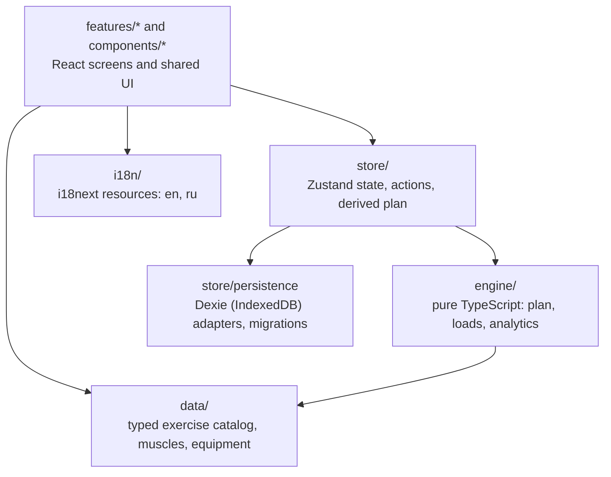

# Architecture

Homebody is a client-only single-page application. There is no server, no
account and no network dependency at runtime: the plan is computed in the
browser and every piece of user data is stored on the device.

This document describes how the code is organized and why. Decisions that
needed weighing are recorded as ADRs in [`docs/adr/`](adr/).

## Goals

1. **Correct numbers.** The training engine is the product. It must be
   deterministic, easy to test and independent of the UI.
2. **Private and offline.** No analytics, no trackers, no third-party requests.
3. **Easy to extend.** Adding an exercise, a locale or a screen should touch
   one obvious place.
4. **Small.** Few runtime dependencies, no heavy UI or chart libraries.

## Layers



Dependencies point downwards only. The engine imports nothing from React, the
store or the browser; the store knows nothing about components.

| Layer      | Location                           | Responsibility                                                                                                     |
| ---------- | ---------------------------------- | ------------------------------------------------------------------------------------------------------------------ |
| Engine     | `src/engine/`                      | Plan builder, load calculator, e1RM, progression, volume and muscle-load analytics, body metrics. Pure functions.  |
| Data       | `src/data/`, `data/exercises.json` | The exercise catalog with its Zod schema, plus muscle and equipment ids.                                           |
| Store      | `src/store/`                       | The single app state document, actions that change it, selectors that derive the plan, persistence and migrations. |
| i18n       | `src/i18n/`                        | i18next setup and one JSON resource file per locale.                                                               |
| Components | `src/components/`                  | Shared presentational building blocks (buttons, panels, charts, lightbox).                                         |
| Features   | `src/features/<name>/`             | One folder per screen: plan, session, calculator, muscles, body, settings.                                         |

## The engine

Everything the app shows about training is derived by three calls:

```ts
const plan = buildPlan(input, exercises); // sessions, exercises, sets
const loads = computeLoads(plan, input, exercises); // weight, reps, e1RM per item
const volume = weeklyVolume(plan, exercises); // planned sets per muscle
```

Rules the engine follows:

- **Pure and deterministic.** No `Date.now()`, no `Math.random()`, no storage,
  no DOM. The current date and any randomness are passed in as arguments.
- **Derived, never stored.** The plan is recomputed from the state whenever the
  state changes. Only the inputs (profile, schedule, equipment) and the user's
  decisions (swaps, edits, ratings, completed sessions) are persisted. This
  keeps stored data small and makes every formula change apply retroactively.
- **Language-neutral.** The engine returns message keys and numbers, never
  display strings. The UI translates them.
- **Dates are ISO strings** (`YYYY-MM-DD`) handled with calendar arithmetic, so
  results do not depend on the device time zone.

The formulas are documented in `docs/TRAINING_SCIENCE.md`, which is added
together with the engine.

## State and persistence

There is one versioned state document. It holds the profile, schedule,
equipment and every decision the user made. Bulky or append-only data lives in
separate IndexedDB tables so the main document stays small:

| Table     | Content                                                                           |
| --------- | --------------------------------------------------------------------------------- |
| `state`   | The single app state document (`version` + data).                                 |
| `history` | One row per exercise per finished session: the result that was actually achieved. |
| `setLogs` | Which sets of which session are ticked.                                           |
| `photos`  | Progress photos (compressed in the browser before saving).                        |

- Every read from storage and every imported backup is validated with Zod and
  run through the migration chain before it reaches the store.
- `localStorage` is used only for UI preferences that must be available before
  the first paint: theme, language and library density.
- A backup is a single JSON file containing all four tables. Import shows a
  preview and asks for confirmation before replacing anything.

## Rendering model

- Function components and hooks only.
- Screens read state through selectors and call store actions; they contain no
  training logic.
- The derived plan is memoized on the state it depends on, so typing in an
  input recomputes it once per committed change.
- Navigation uses hash routes (`#/plan`, `#/session/<id>`, ...). Deep links and
  the browser back button work on any static host without rewrite rules.

## Styling

CSS Modules with CSS custom properties. Design tokens (colors, type, radii)
are defined once in `src/styles/tokens.css` for the light and dark themes; the
theme follows the system preference unless the user overrides it. Fonts are
bundled with the app and never loaded from a third-party host.

## Localization

All user-facing text lives in `src/i18n/locales/<locale>.json`. English is the
fallback; Russian ships alongside it. Exercise names are part of the dataset
(`name.en`, `name.ru`). Numbers and dates are formatted with `Intl`.

## Testing

| Level      | Tool                     | What it covers                                                            |
| ---------- | ------------------------ | ------------------------------------------------------------------------- |
| Unit       | Vitest                   | The engine (coverage gate of 90 %), state migrations, formatting helpers. |
| Component  | Vitest + Testing Library | Interactive components and screens against an in-memory store.            |
| End-to-end | Playwright               | Critical flows on phone and desktop viewports.                            |
| Data       | Zod validation script    | The exercise dataset, in CI.                                              |

## Repository layout

```
src/
  engine/        pure training logic and its tests
  data/          typed catalog loader, muscles, equipment
  store/         state, actions, selectors, persistence, migrations
  i18n/          i18next setup and locale files
  components/    shared UI
  features/      plan, session, calculator, muscles, body, settings
  styles/        tokens and base styles
data/            source dataset
public/          static assets, exercise photos
scripts/         dataset validation and build tooling
e2e/             Playwright specs
docs/            this file, ADRs, progress log
```
